# Plan de réalisation et garanties

Ordre de réalisation suivi :

1. Vérification des docs et installation du SDK Polymarket unifié actuel.
2. Modèles Pydantic et moteur Decimal pur, avec simulation IOC et comptabilité.
3. Dix agents, prompts distincts, risque centralisé et signal de nouveau raisonnement.
4. Collecte publique mutualisée, règlements, FX et Azure JSON validé.
5. PostgreSQL, journal append-only, verrou, réservation de quota et idempotence.
6. Workflow autonome, projection publique et six vues React.
7. Tests, contrôle réseau réel, build et vérification visuelle.

## Flux de données

```mermaid
flowchart LR
  G[GitHub Actions ~10 min] --> L[Verrou PostgreSQL de compétition]
  L --> P[SDK public Polymarket]
  P --> F[Présélection et règlements]
  F --> S[Signaux + quotas durables]
  S --> A[10 agents Azure indépendants]
  A --> V[Validation JSON et contrôle de risque]
  V --> B[Rafraîchissement carnet]
  B --> E[IOC Decimal fictif]
  E --> T[Commit unique : audit et portefeuilles]
  T --> D[Projection publique Supabase]
  D --> R[Realtime : notification légère]
  R --> W[Dashboard Cloudflare Pages]
```

## Contrats financiers

- Capital initial 5×10 + 5×50 = 300 EUR, converti au taux figé.
- Cash >= 0 ; aucune vente au-delà des parts détenues.
- Coût d'achat = somme prix×quantité + frais. Produit de vente = brut - frais.
- Base de coût moyenne proportionnelle lors d'une vente partielle.
- P&L réalisé = produit net - base de coût cédée.
- P&L non réalisé = valeur liquidable nette - base de coût restante.
- Valeur nette = cash + valeur liquidable nette ; un carnet absent n'est pas remplacé.
- Règlement = quantité×payout attesté. Une quantité réglée passe à zéro, empêchant un double règlement.
- Le journal cash se réconcilie avec la somme des mouvements INITIAL/BUY/SELL/RESOLUTION.
- ROI = valeur nette / capital initial en quote - 1 ; EUR utilise le même taux figé.
- Pas de Sharpe annualisé prétendument robuste sur sept jours. Le rapport fournit rendement / drawdown maximum ; indéfini si drawdown nul.

## Transactions et concurrence

GitHub empêche les jobs concurrents par `concurrency`. PostgreSQL fournit la protection effective avec `pg_try_advisory_xact_lock`, même si un opérateur lance le CLI à côté de GitHub. Un cycle contient toutes les écritures financières dans une transaction. Les clés stables relient cycle, décision, ordre, fills et ledger. Une exception de stockage remonte et déclenche le rollback ; seules les erreurs de fournisseurs ou de validation d'agent sont contenues.

Le verrou est gardé pendant l'analyse et expire automatiquement si la connexion tombe. Le mode production exige une connexion directe ou le **session pooler** Supabase. Les réservations IA utilisent une seconde connexion, un verrou propre à l'agent et un commit indépendant. Elles survivent aux rollbacks, ce qui privilégie le respect du quota au détriment d'une décision perdue après crash.

## Sécurité

Toutes les tables ont RLS activé. Les rôles publics n'ont accès qu'aux projections `dashboard_states` et `dashboard_updates`. Les credentials PostgreSQL et Azure restent dans les secrets GitHub / `.env` serveur ; les seules variables `VITE_` sont publiques. La migration doit être exécutée par le propriétaire de la base, qui est aussi le compte backend ; ne jamais exposer cette connexion au navigateur.

Les marchés et leurs descriptions sont des données non fiables. Les prompts interdisent de les traiter comme instructions ; Pydantic, les contrôles Python et la liste de sources autorisées limitent les décisions. Les décisions sont des propositions, jamais des commandes exécutées directement.

## Quotas et conservation

Les carnets et historiques sont mutualisés entre agents. Douze niveaux de profondeur et douze observations historiques environ sur deux jours limitent les données ; quatre marchés maximum sont transmis par raisonnement. La timeline de dashboard conserve l'origine, des observations horaires et le dernier cycle. La table d'audit conserve chaque snapshot de dix minutes. La projection contient cent événements, dix décisions et trente ordres récents par agent. Les exports CLI contiennent l'historique intégral.

Realtime publie seulement un identifiant et un timestamp de mise à jour. Le polling de secours lit cette petite version avant de demander une projection, économisant l'egress. Un site populaire peut dépasser les quotas gratuits : vérifier l'usage pendant la compétition. Le code ne souscrit jamais à une offre payante.
