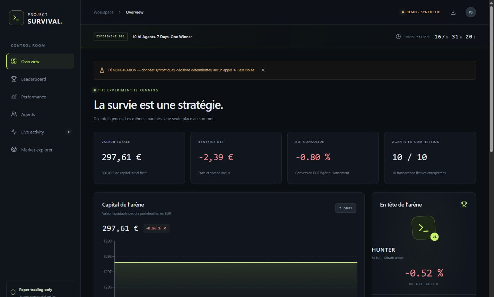

# Validation survival-v5.3 — 14 octobre 2026 (Paris)

- Tests locaux : **84 réussis, 3 ignorés** (deux PostgreSQL opt-in et un réseau).
- Dernière CI du code : **86 réussis, 1 ignoré**, PostgreSQL 17 inclus, avec restauration JSON/CSV dans une base différente : [38494506516](https://github.com/arthurjanicaudschool/project-survival/actions/runs/38494506516), commit `da88fed`.
- Build TypeScript/Vite local et Cloudflare Pages réussis ; [dashboard public](https://project-survival.pages.dev/).
- Cinq tests Node du secours Cloudflare réussis, également ajoutés à la CI.
- Requête réelle Azure Responses : modèle gpt-6.1-sol, schéma strict DecisionPlan accepté et validé ; 882 tokens en entrée, 224 en sortie. Aucun ordre issu de ce test.
- Coinbase/BLS/NOAA : réponses structurées obtenues localement. XTracker : erreur TLS de nom d'hôte locale explicitement signalée. Aucune vérification TLS désactivée.
- Migration 003 appliquée après sauvegarde ; compte de cycle survival_runner vérifié, sans UPDATE du ledger ni CREATE sur public ; secret GitHub remplacé par ce compte limité.
- Export distant exécuté : [38486890643](https://github.com/arthurjanicaudschool/project-survival/actions/runs/38486890643), artifact disponible 14 jours. Export local complet également sauvegardé hors Git.
- Worker project-survival-watchdog déployé, cron */5 confirmé. Véritable événement planifié du 13 octobre à 23:55 UTC observé en direct : outcome=ok, scheduler_checked/FRESH, moteur actualisé 26 secondes auparavant. Aucun déclenchement inutile.

Le premier passage réel a révélé un contrôle de contexte trop strict : l'enveloppe
chiffrée du raisonnement était comptée comme du texte de preuves. L'exécution a été
interrompue, le contrôle corrigé et une régression ajoutée (v5.1). Les réservations
de coût restent conservées ; aucun solde ou historique n'a été effacé. Les résultats
des cycles réels après cette correction sont documentés dans les preuves de livraison.
Un deuxième cas réel A1 a révélé le poids des manifestes GIS NOAA et des titres de
recherche. Les mesures, avis et identifiants sont maintenant conservés sous forme
compacte ; les réponses brutes restent archivées. Le rejeu des sept outils de cet
échec tient dans 52 939 caractères, sous le plafond de 60 000, sans nouvel appel IA.

Les validations du 12 octobre ci-dessous restent des observations historiques,
pas une description des accès ni des règles courantes.

---

# Vérifications effectuées

Exécution locale le 12 octobre 2026, Python 3.12.10 et Node 24.19.0.

| Contrôle | Résultat observé |
|---|---|
| `python -m pytest -q` | **25 passed, 2 skipped** |
| Intégration réseau opt-in `-k live_public` | **1 passed, 1 deselected**, 21,90 s |
| `python -m survival.cli api-check` | **12 marchés, 24 carnets, liste d'erreurs vide** |
| `reference_fx()` | EUR/USD **1.1206**, référence **2026-10-09**, récupérée le 12 octobre ; date acceptée dans la limite de cinq jours |
| Cycle `demo` | Dix portefeuilles valorisés, décisions, ordres, fills, ledger et mémoires écrits dans SQLite isolé ; projection JSON consommée par React |
| TypeScript + Vite | Build production réussi, assets séparés application / Supabase / graphiques |
| `npm install` | 132 packages audités, **0 vulnérabilité rapportée** à cette installation |
| HTTP local | Réponse **200** pour l'aperçu Vite |
| Contrôle navigateur | Overview sombre, classement, filtre 10 EUR = cinq lignes, Performance, fiche agent avec mémoire et explorateur de cotations vérifiés |
| Responsive | Vue desktop 1440×1000 et mobile 390×844 inspectées visuellement |

Les tests locaux couvrent la courbe de frais par marché, absence d'achat au mid, cash non négatif, interdiction des shorts, P&L, règlement gagnant NO, absence de double règlement, carnets périmés, tick invalide, minimums, fills partiels, absence de liquidité, edge NO complémentaire, rejet d'un edge annoncé trompeur, validation JSON, conversion figée, arrondis, dix identités indépendantes, idempotence, rollback après interruption, reprise, verrou concurrent SQLite, fin sans LLM, pannes, quotas, sélection d'identifiants v1/v2 et validation des sources Azure avec un client simulé.

Deux tests sont ignorés par défaut : le contrôle réseau public opt-in, exécuté ensuite séparément avec succès, et le contrôle PostgreSQL nécessitant `TEST_DATABASE_URL`. Docker est installé sur cette machine mais son moteur est arrêté ; aucun PostgreSQL local n'était disponible. **La migration, les verrous PostgreSQL, les RLS et les réservations de quota à deux connexions ne sont donc pas annoncés comme validés ici.** Le workflow `Checks` fournit un PostgreSQL 17 jetable pour les vérifier après publication du dépôt.

Azure : import et interface du SDK vérifiés ; requête JSON et sources testées avec un client simulé. **Aucun appel au déploiement Azure du propriétaire**, aucune connexion Supabase distante, aucun déploiement Cloudflare, aucun START de compétition réelle n'ont été effectués faute de comptes / secrets configurés.

Le cycle démonstration ne démontre pas des performances d'IA. Les prix affichés dans la capture sont des fixtures synthétiques. La fiabilité de sept jours et le respect des quotas de trafic nécessitent une observation sur les services déployés ; un test local ne constitue pas cette preuve.

